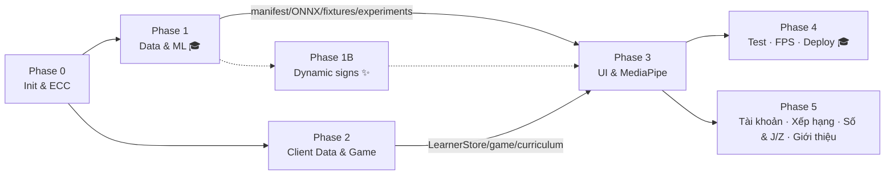

# 07 — Master Implementation Plan: SignLingo AI

> **Trạng thái:** v0.3 · **Ngày:** 2026-11-22 · **v0.2:** bỏ backend; Phase 2 đổi thành *Client Data & Game*; thêm deploy Vercel. · **v0.3:** đồng bộ trạng thái task với code; thêm **Phase 5** (tài khoản Supabase tùy chọn, bảng xếp hạng, số 0–10, J/Z, giao diện hồng, trang giới thiệu, `/login`).
> Truy vết: `FT-*`, `AC-*` ([01_PRD](01_PRD.md)) · lưu trữ ([03_DATA_STORAGE](03_DATA_STORAGE.md)) · hợp đồng ([04_CONTRACTS](04_CONTRACTS.md)).
> **Quy tắc task:** mỗi task ≤ ~100 dòng code nguồn (không tính test/lock/file sinh); 1 task = 1 lượt Agent = 1 commit. Vòng: **Plan → Review Plan → Code → Test**. Task gắn **[R]** phải duyệt plan trước khi code.
> Ký hiệu: 🎓 = bắt buộc cho chấm điểm Tuần 5 · 🚀 = MVP · ✨ = mở rộng · ☑ = xong · ☐ = chưa.

---

## 0. Lộ trình tổng & cổng chất lượng



| Cổng | Điều kiện qua cổng |
|---|---|
| G0 | CI xanh trên GitHub cho `ml/`, `frontend/`, e2e smoke; bản "Hello" deploy được lên Vercel với header COOP/COEP |
| G1 | AC-ML-01..09 đạt; manifest + ONNX + fixture + experiments JSON đã publish vào `frontend/public/` |
| G2 | `src/storage`, `src/game`, `src/content` có unit test xanh; AC-GAM-01, AC-ACC-01/02 đạt ở mức unit/integration |
| G3 | Luồng học Cấp 1 chạy end-to-end với fake camera; AI Lab hiển thị số từ JSON |
| G4 | AC-PERF-01..03, AC-UI-02, AC-PRIV-01 đạt trên bản deploy Vercel; README hoàn chỉnh (AC-REPO-*) |

### Đường găng cho Tuần 5 (🎓)
P0 còn lại → **P1 (toàn bộ trừ 1B)** → P3-01, P3-07..15, P3-20..22 (Free Practice + AI Lab) → P4-01..07, P4-10..12.
Phase 2 và phần còn lại của Phase 3 (Skill Tree, Lesson Player đầy đủ, gamification) làm song song nếu đủ người, nếu không thì sau buổi chấm.

> **Nguyên tắc số liệu (2026-11-18):** các báo cáo tuần 3–4 cũ và mã đi kèm **không dùng**. Mọi mã được viết lại trong repo này; mọi con số do thí nghiệm của repo sinh ra (JSON có seed + git commit). Dữ liệu đầu vào đã có ở `data/`: Kaggle CSV và `keypoint.csv` (đã kiểm cấu trúc).

---

## Phase 0 — Khởi tạo & ECC

**Context:** 02_ARCH §3, §8, §9 · 06_ECC.

| ☐/☑ | ID | Task | Files | Guide | Test |
|---|---|---|---|---|---|
| ☑ | P0-01 🎓 | Git init, `.gitignore`, `.editorconfig`, `README.md` khung | gốc | — | — |
| ☑ | P0-01b | `LICENSE` | gốc | MIT, chủ bản quyền "SignLingo AI contributors" (đổi tên nếu nhóm muốn) | — |
| ☑ | P0-02 🎓 | `CLAUDE.md` gốc + `ml/`, `frontend/` + `.claude/settings.json` (permissions) | theo 06 §2 | Đã đồng bộ v0.2 | — |
| ☑ | P0-03 🎓 | Scaffold `ml/` (pyproject, ruff, pytest, `config.py` seed 42 + 24 nhãn) | `ml/` | Tạm dùng venv + pip | Unit: 3 test config ✅ |
| ~~P0-04~~ | — | ~~Scaffold backend~~ | — | **Bỏ (v0.2)**, đã xóa thư mục | — |
| ☑ | P0-05 🎓 | Scaffold `frontend/` (Vite, React 19, TS 6, Tailwind 4, Vitest, ESLint C1/C3) | `frontend/` | TS ghim 6.x | Unit: render App ✅; build ✅ |
| ~~P0-06~~ | — | ~~docker-compose Postgres~~ | — | **Bỏ (v0.2)**, đã xóa | — |
| ☑ | P0-07 🎓 | `shared/contracts/schemas/model_manifest.schema.json` | `shared/` | — | Unit (ml): 6 test schema ✅ |
| ☑ | P0-08 🎓 | CI GitHub Actions: job `ml`, `frontend` | `.github/` | Đã bỏ job backend | ☐ **Chưa chạy trên GitHub** |
| ☑ | P0-09 🎓 | `e2e/` Playwright + Chrome fake camera | `e2e/` | `PW_CHANNEL=chrome` dùng Chrome cài sẵn | E2E smoke ✅ (local) |
| ☐ | P0-10 | Cài skills theo 06 §3 + tạo `.claude/agents`, `.claude/skills` nội bộ | `.claude/` | **Chờ duyệt danh sách skill** | — |
| ☑ | P0-11 🎓 | `frontend/vercel.json` (SPA rewrite, COOP/COEP, CSP, Permissions-Policy, cache) + Vite dev/preview cùng header COOP/COEP | `frontend/` | Theo 02 §7, §9. CSP chỉ áp trên Vercel; script chống nháy theme (P3-01) phải là file ngoài hoặc thêm hash vào CSP | E2E `crossOriginIsolated` ✅ (local dev) · ☐ kiểm lại trên Preview URL |
| ☑ | P0-12 | Hooks (ruff format, prettier, chặn ghi thư mục cấm) + script CI C7 (≤ 100 dòng/task) | `.claude/`, `.github/` | 06 §4–5. Hook chặn ghi + ruff format đã chạy; **prettier chưa cài** nên chưa có hook cho TS; script C7 ở `scripts/check_diff_size.py` (job CI chỉ cảnh báo) | Hook chặn `docs/course` đã thử ✅ |
| ◐ | P0-13 🎓 | Ghim runtime: `.nvmrc` (Node LTS dùng chung máy & CI), `.python-version`, `engines`; `.gitattributes` (`eol=lf`); cài **uv** + `uv.lock` (hoặc chốt pip + `requirements.lock`) | gốc, `ml/` | Đồng bộ CI | CI xanh với đúng phiên bản | **Xong:** `.nvmrc`, `.python-version`, `engines`, `.gitattributes`. **Còn:** cài uv + `uv.lock`.
| ☐ | P0-14 🎓 | Commit baseline, push GitHub, tạo project Vercel (Root = `frontend/`), xác nhận Preview + Production | — | **Người dùng: chủ project Vercel, repo public/private** | URL production mở được, camera xin quyền được (HTTPS) |

**3 lớp kiểm thử Phase 0:** Unit = config, schema, App · Integration = `pnpm build` + `pnpm preview` có header đúng · E2E = Playwright smoke + `crossOriginIsolated` (local và trên Preview URL).

---

## Phase 1 — Data & ML Pipeline 🎓

**Mục tiêu:** xây pipeline thật: dữ liệu → baseline → CNN → landmark model → ONNX → publish vào `frontend/public/`, kèm signer-holdout. **Context:** 01_PRD §2, §5.1, §6.1 · 02_ARCH §4 · 03_DATA §4–5 · 04_CONTRACTS §2–4.

### 1A. Dữ liệu ảnh (Sign Language MNIST)

| ☐ | ID | Task | Files (`ml/src/signlingo_ml/…`) | Guide | Test |
|---|---|---|---|---|---|
| ☑ | P1-01 | Load CSV + quality report (NaN, dup, label range, balance, pixel range) | `data/load.py`, `data/quality.py` | Dataclass `QualityReport`, ghi JSON | Unit: fixture có NaN/dup → đếm đúng |
| ☑ | P1-02 | Clean + transform (remap nhãn, /255, reshape) | `data/transform.py` | Hàm thuần | Unit: nhãn 10→9, 24→23; giá trị ∈ [0,1] |
| ☑ | P1-03 [R] | Group split: thumbnail 10×10 **chuẩn hóa từng ảnh** → Ward 70 cụm/lớp → ~15% ảnh (nguyên cụm) = val; `split_v1.parquet` | `data/split.py` | Số cụm (70) và kích thước thumbnail là **giả thuyết thiết kế**, chưa được kiểm chứng độc lập (xem P1-10). Số đo của ta trên dữ liệu thật (Logistic Regression pixel): không chuẩn hóa từng ảnh val 0,987 / test 0,691 (vẫn rò rỉ); có chuẩn hóa val 0,773 / test 0,705 | Unit: 0 group overlap, bản sao cùng ảnh gốc cùng nhóm kể cả khi đổi sáng/tương phản, tỉ lệ val ≈ 15% ± 3%, deterministic ✅. Thật: 1.680 nhóm, train 23.269 / val 4.186, 24 lớp đều có ở cả hai |
| ☑ | P1-04 | Guard: `load_split(name, final=False)` raise nếu đọc `test` khi chưa `final` | `data/access.py` | Dùng ở mọi script train/tune | Unit |
| ☑ | P1-05 | Features: pixel 784, HOG 1296 | `features/pixel.py`, `features/hog.py` | scikit-image | Unit: shape |
| ☑ | P1-06 | Augment: xoay, dịch, zoom, sáng/tương phản, **no hflip**. Khoảng biến thiên (đề xuất ±10°, ±2 px, 0,9–1,1, ±15%) là **giả thuyết**, chọn trên validation | `features/augment.py` | p = 0,7 | Unit: không hflip; seed tái lập · Test ✅ (6): shape/dtype/[0,1], seed tái lập, p=0 giữ nguyên, tham số 0 = đồng nhất, không có lật ngang |
| ☑ | P1-07 | Metrics: acc, macro-F1, per-class F1, CM row-norm, top-k confusions, latency | `evaluate/metrics.py` | Khớp sklearn | Unit |
| ☑ | P1-08 | Experiment logger theo `experiment.schema.json` (tạo schema trong task này) | `evaluate/logger.py`, `shared/contracts/schemas/experiment.schema.json` | 04 §4.2 | Unit: validate schema |
| ☑ | P1-09 | Baselines: Majority, LR, RF(200), LinearSVM, MLP 256-128 × {pixel, HOG}. Danh sách là lựa chọn thiết kế; **kết quả tự đo**, ≥ 3 seed khi có thể | `train/baselines.py`, `configs/baselines.yaml` | Scaler fit trên train (AC-ML-03) | Unit: scaler mean = mean(X_train) · Đã chạy thật cả 6 mô hình (mô hình ngẫu nhiên 3 seed; LR, SVM, Majority xác định nên 1 lần). Kết quả tổng hợp ở `ml/reports/summary.md`; Linear SVM trên HOG mất ~39 phút vì chạy primal (`dual=False`), nên chỉ chạy 1 lần |
| ☑ | P1-10 | Leakage study: LR pixel, random vs group split | `train/leakage_study.py` | kind = `leakage_study` | Integration: gap random > gap group · Đã chạy thật 3 seed; thêm chẩn đoán khoảng cách ảnh gần nhất (không dùng test để chọn); schema thêm `diagnostics` tùy chọn |

### 1B'. CNN PyTorch

| ☐ | ID | Task | Files | Guide | Test |
|---|---|---|---|---|---|
| ☑ | P1-11 | CNN nhỏ (Conv16→Pool→Conv32→Pool→Dense128+Dropout→24). **Nguồn gốc kiến trúc:** các kích thước ban đầu đến từ mô tả trong báo cáo cũ (không đáng tin), chỉ là **giả thuyết xuất phát**; độ rộng là tham số để P1-13 so sánh biến thể trên **validation** | `models/cnn.py` | Số tham số được đo và ghi vào log (bản mặc định 208.728 là hệ quả của kiến trúc, không phải bằng chứng) | Unit ✅: shape, lớp, dropout, seed, gradient, độ rộng tùy chỉnh |
| ☑ | P1-12 [R] | Trainer: Adam wd 1e-4, cosine LR, label smoothing .05, batch 128, early stop theo val macro-F1 (patience 3), deterministic | `train/trainer.py` | Dùng lại cho landmark MLP | Unit: 2 epoch tiny → loss giảm; cùng seed → cùng kết quả · Đã duyệt plan. Unit ✅ (6): loss giảm, cùng seed tái lập, early stop theo val, khôi phục epoch tốt nhất, augment mỗi epoch seed mới, test không đọc khi chưa `eval_test`. Đo thật: ~7 s/epoch trên CPU 6 luồng |
| ☑ | P1-13 | Sweep 4 cấu hình + tăng epoch tới 30 | `configs/cnn_*.yaml`, `train/run_cnn.py` | Chọn theo val | Integration: 1 config tiny → JSON · Đã chạy thật: 5 cấu hình × 3 seed, chọn theo val; thắng `wide` (val 0,975 ± 0,002), test chấm 1 lần: Macro-F1 0,971 ± 0,003 so với MLP+HOG 0,911 ± 0,003. Chi tiết và cảnh báo: `ml/reports/summary.md` · Vòng 2 (30 epoch, val): wide_e30 0,980 ± 0,005 tốt nhất; chọn theo val → test 1 lần: mô hình đơn acc 0,975 ± 0,002 / Macro-F1 0,974 ± 0,003 (sai 2,5%); tập hợp 5 seed (val 0,988 ≥ trung bình thành viên 0,981, đúng quy tắc khai báo trước) acc 0,979 / F1 0,979 (sai 2,1%). Cải thiện so với vòng 1 (sai 2,8%) nhỏ, gần mức nhiễu seed |
| ~~P1-14~~ | — | ~~So với bản NumPy tuần 4~~ | — | **Bỏ (2026-11-18)**: không dùng mã cũ | — |

### 1C. Landmark model (cho web)

| ☐ | ID | Task | Files | Guide | Test |
|---|---|---|---|---|---|
| ☑ | P1-15 [R] | `normalize_lm_v1`: tịnh tiến cổ tay về (0, 0), chia cho max(|x|,|y|), flatten x0,y0,…; hệ số 0 → None. **Không lật gương.** Đặc tả suy ra từ dữ liệu thật (33.536 hàng), thay cho đặc tả cũ sai (chuẩn Euclid + lật theo handedness) | `landmarks/normalize.py` | 04 §3.3 | Unit ✅ (10): bất biến tịnh tiến/tỉ lệ (hypothesis), cổ tay (0,0), max|giá trị| = 1, idempotent, z bị bỏ qua, suy biến, **tái tạo đúng cả 33.536 hàng của `keypoint.csv` (sai số ≤ 1e-6)** |
| ☑ | P1-16 | Sinh golden fixture `landmarks_lm-v1.json` (≥ 50 mẫu, có tay trái, có ca scale = 0) | `landmarks/fixtures.py` | Ghi vào `shared/contracts/fixtures/` | Unit: round-trip · Đã sinh: 61 trường hợp (50 hàng thật của keypoint.csv đưa ngược về tọa độ ảnh + z, nhãn tay trái, suy biến, gần suy biến, rất nhỏ); ngưỡng suy biến 1e-12 ghi trong file. Test ✅ (6) |
| ☑ | P1-17 | Loader `keypoint.csv` ✅ (bỏ 1 dòng hỏng, bỏ J/Z, `order_split` = 20% cuối mỗi lớp theo thứ tự file). **Còn:** `ingest.py` đọc `ml/data/raw/webcam/*.json` + schema `landmark_capture` | `landmarks/dataset.py` ✅, `landmarks/ingest.py` ☐, `shared/contracts/schemas/landmark_capture.schema.json` ☐ | File thật: 36.402 dòng, 1 dòng hỏng (35522), 2.865 dòng J/Z bị bỏ → **33.536** mẫu, 24 lớp (số đếm trực tiếp từ file). `keypoint.csv` không có session/signer: thứ tự file chỉ là *giả định* thứ tự thu và chưa phải signer-holdout | Unit ✅ (dòng hỏng, ô có khoảng trắng, J/Z, order_split) · Đã thêm `landmark_capture.schema.json` và `landmarks/ingest.py` (đọc file webcam, chuẩn hóa lm-v1, giữ `signer_id`, báo lỗi file sai schema). Test ✅ (5) |
| ☑ | P1-18 | Landmark augment: mirror, xoay ±15°, jitter, scale | `landmarks/augment.py` | Sau normalize | Unit · Test ✅ (7): hàng hợp lệ lm-v1, tái lập theo seed, tham số 0 = đồng nhất, lật chỉ đổi dấu x, xoay giữ hình dạng, nhiễu không dịch cổ tay. `p_mirror` mặc định 0 (lật là thí nghiệm, không phải giả định) |
| ☑ | P1-19 | Landmark-MLP 42→128→64→24 (PyTorch) qua `trainer.py` | `models/landmark_mlp.py`, `configs/lm_mlp.yaml` | Thử `xyz` nếu đủ dữ liệu webcam | Integration: tiny → JSON · Đã chạy thật (file-order split 60/20/20 + đệm 2%, KHÔNG phải signer-holdout): val Macro-F1 canonical 0,746 ± 0,003, mirror_aug 0,696 ± 0,010, base 0,630 ± 0,023, no_aug 0,630 ± 0,028; thắng `canonical`, test Macro-F1 0,664 ± 0,004 (acc 0,709). Điểm yếu: U→R 76,7%, F→B 51%, M→N 50%. Chi tiết: `ml/reports/summary.md` |
| ☑ | P1-19b | Cải thiện landmark: đặc trưng kỹ thuật (210 khoảng cách chia kích thước tay, 15 cosin góc gập, 16 đặc trưng quan hệ/chéo ngón có dấu), MLP lớn hơn, gradient boosting, tập hợp seed; chọn chỉ theo val | `landmarks/features.py`, `train/landmark_improve.py` | Đặc trưng bất biến xoay/tỉ lệ/lật (có test); chuẩn hóa đặc trưng chỉ theo train; HGB không dùng dừng sớm tích hợp (rò rỉ khung liền kề) | Đã chạy thật: val xy 0,777 → xy+khoảng cách+góc 0,842; MLP 512-256 0,850; HGB 0,810; tập hợp 5 seed 0,857. Test (chấm 1 lần cho mô hình chọn theo val): đơn acc 0,768 / F1 0,769 ± 0,016 (sai 23,2%), tập hợp acc 0,782 / F1 0,778 (sai 21,8%), so với 0,709 / 0,664 (sai 29,1%) trước đó. Lỗi đổi chỗ: X F1 0,0, U→R 71%. Test landmark đã được xem 2 lần; vẫn KHÔNG phải signer-holdout |
| ☑ | P1-20 | Class templates (15 góc khớp mean/std mỗi lớp) + `confusable` từ CM | `landmarks/templates.py` | Dùng cho FT-LRN-04 | Unit: ngón duỗi ≈ 180° · Test ✅ (5). Mẫu = trung bình/độ lệch chuẩn 15 góc khớp (độ) cho 24 chữ trên tập train; `confusable` tính từ ma trận nhầm **validation** (không dùng test) |
| ◐ | P1-21 🎓 | Signer-holdout eval (**cần ≥ 3 người × 30–50 mẫu/chữ thu bằng `/collect` hoặc script tạm**) | `evaluate/signer_holdout.py` | Leave-one-signer-out | Integration: fixture 2 signer giả lập · Đã chọn phương án A (nhóm thu ≥ 3 người). Đã viết `evaluate/signer_holdout.py` (leave-one-signer-out: `kaggle_only` và `with_others`, không chọn lại cấu hình) và test ✅ (3) trên dữ liệu giả. Đã có `ml/tools/capture.py` (OpenCV + MediaPipe, chỉ lưu tọa độ, mã người ẩn danh) và `landmarks/capture_io.py`; test ✅ (4), mô hình bàn tay nạp được và không thấy tay trên khung đen. CHƯA chạy với webcam thật và CHƯA có số đo: chờ nhóm thu ≥ 3 người |

> Nếu trang `/collect` (P3-24) chưa xong khi cần thu dữ liệu, dùng script Python tạm `ml/tools/capture.py` (OpenCV + MediaPipe Python) xuất **cùng schema** `landmark_capture`.

### 1D. Export, Publish & Báo cáo

| ☐ | ID | Task | Files | Guide | Test |
|---|---|---|---|---|---|
| ☑ | P1-22 | Export ONNX (opset 17) CNN + Landmark-MLP; softmax ngoài graph | `export/onnx_export.py` | Dynamic batch | Integration: **parity ≤ 1e-4** (AC-ML-08) · Chỉ xuất **mô hình landmark** (CNN ảnh chưa xuất: web dùng landmark). Đặc trưng (hướng, 210 khoảng cách, 31 góc/chéo ngón) và chuẩn hóa nằm TRONG đồ thị; đầu ra là `probs` đã trung bình tập hợp (bỏ quy ước 'softmax ngoài graph'). Test ✅ (5): đặc trưng torch = numpy, bất biến lật gương, ONNX khớp torch ≤ 1e-4 (đo thật: 3,3e-7) với batch 1/17/256 |
| ☑ | P1-23 | Manifest builder (sha256, labels, preprocess_version, recommended, templates, confusable, metrics) | `export/manifest.py` | Schema P0-07 | Unit · Test ✅ (6). `build_release` huấn luyện lại đúng 5 thành viên (seed 42–46), kiểm ONNX khớp torch và **Macro-F1 val bằng đúng bản ghi thí nghiệm (lệch 0,00)** rồi mới ghi manifest; số đo trong manifest chép từ bản ghi, không tính lại trên test. Không có số signer-holdout vì chưa đo |
| ☑ | P1-24 | Publish: copy vào `frontend/public/models/` + `index.json`; experiments → `frontend/public/data/experiments/` + `index.json` (tạo `model_index`, `experiment_index` schema) | `export/publish.py` | Không ghi đè version cũ; bỏ trường nặng | Integration: đủ file, đúng schema · Đã xuất bản: `frontend/public/models/` (ONNX 5,68 MB + manifest + index.json), `public/data/experiments/` (88 file + index). Bản đã phát hành là bất biến (chặn ghi đè khác nội dung cùng phiên bản); thêm schema `experiment_index`, `model_index` |
| ☑ | P1-25 | Figures: CM, per-class F1, bar so sánh, leakage, curves | `evaluate/figures.py` | `reports/figures/` | Integration: PNG tồn tại · Đã sinh 7 hình từ file kết quả thật (`ml/reports/figures/`): so sánh mô hình (Macro-F1 test ± std seed), leakage study (độ chính xác và khoảng cách ảnh gần nhất), ma trận nhầm CNN và landmark, F1 từng chữ, đường cong học của hai mô hình. Hàm báo rõ hình nào bị bỏ qua vì thiếu dữ liệu, không vẽ giả. Test ✅ (5). Đã xem bằng mắt: sửa lỗi nhãn đè nhau và chú thích che cột, những lỗi test không bắt được |
| ◐ | P1-26 🎓 | Entrypoint `python -m signlingo_ml.pipeline all\|data\|baselines\|cnn\|landmarks\|export\|publish` | `pipeline.py` | Idempotent, cache | **E2E ML:** `all` trên tiny trong CI (< 5 phút); đầy đủ trên máy nhóm → AC-ML-01, 05, 06 · Đã có `pipeline.py` (data, baselines, cnn, landmarks, export, publish, report; cache theo file đầu ra, `--force`, `--dry-run`). Test ✅ (5), chạy thật `--dry-run` báo cả 7 bước cached. CHƯA có: chạy `all` trên dữ liệu tiny trong CI (cần tiny fixture cho từng bước) |
| ◐ | P1-27 🎓 | `ml/README.md` + `reports/RESULTS.md` (RQ1–RQ3, số lấy từ JSON) | docs | Bám rubric | Review thủ công · Đã viết `ml/README.md` và `ml/reports/RESULTS.md` (RQ1–RQ3, số chép từ JSON và `summary.md`). Còn thiếu: wording chính thức RQ1 (U2), số signer-holdout (P1-21) và FPS trình duyệt (RQ3, Phase 4) ghi rõ là chưa đo |

**3 lớp kiểm thử Phase 1:** Unit = transform, split, guard, features, augment, metrics, normalize, templates, manifest · Integration = pipeline con trên `tiny_mnist.csv`, `tiny_keypoint.csv`; ONNX parity; publish đúng schema · E2E = `pipeline all` từ repo sạch, chạy 2 lần lệch Macro-F1 ≤ 0,005.

---

## Phase 1B — Dynamic signs (J, Z, từ vựng Cấp 3) ✨

> **Gated:** cần người dùng chọn nguồn dữ liệu chuỗi landmark (kiểm giấy phép) hoặc tự thu.
> **Cập nhật 2026-11-22:** J, Z (và số 10) đã nhận diện được bằng **luật hình học trên quỹ đạo** (P5-08, không học máy). Phase 1B vẫn mở nếu muốn thay luật bằng mô hình có thí nghiệm, và cho từ vựng Cấp 3.

| ☐ | ID | Task | Guide | Test |
|---|---|---|---|---|
| ☐ | P1B-01 [R] | Chọn dataset + danh sách từ (người dùng duyệt) | ADR | — |
| ☐ | P1B-02 | Loader chuỗi, resample T = 32, normalize lm-v1 từng khung | `landmarks/sequence.py` | Unit: shape (T, 42) |
| ☐ | P1B-03 | GRU 2 lớp / 1D-CNN temporal | `models/seq_model.py` | Unit |
| ☐ | P1B-04 | Train + eval (signer split) + export ONNX + manifest task `dynamic_words` | | Integration: parity |

---

## Phase 2 — Client Data & Game 🚀 (thay cho Backend)

**Mục tiêu:** lớp dữ liệu và luật chơi chạy hoàn toàn trong trình duyệt. **Context:** 01_PRD §5.2–5.4, §6.3 · 02_ARCH §6 · 03_DATA · 04_CONTRACTS §6–7.

| ☐ | ID | Task | Files (`frontend/src/…`) | Guide | Test |
|---|---|---|---|---|---|
| ☑ | P2-01 | Types dùng chung (`Settings`, `Stats`, `SessionRecord`, `PerfRecord`, `Curriculum`…) | `storage/types.ts`, `content/types.ts` | Theo 03 §3 | Typecheck · Typecheck ✅ |
| ☑ | P2-02 [R] | Storage adapter: get/set JSON có try/catch, fallback bộ nhớ, `available`, prefix `signlingo:v1:` | `storage/kv.ts` | Ném lỗi không ra ngoài | Unit: localStorage throw → fallback, `available=false` (AC-ACC-02) · Test ✅ (6): storage bị chặn hoặc đầy → bộ nhớ tạm, `available=false`, JSON hỏng → giá trị mặc định |
| ☑ | P2-03 | Migration framework (`schema_version`, `migrate(v→v+1)`) | `storage/migrate.ts` | v1 là bản đầu | Unit: dữ liệu thiếu version → v1 · Test ✅ (5): thiếu version → v1, chuỗi bước, từ chối bản mới hơn hoặc thiếu bước |
| ☑ | P2-04 | ESLint C3 (`game/**` không React) + C4 (`no-restricted-globals localStorage` ngoài `storage/**`) | `eslint.config.js` | | Lint bắt vi phạm mẫu · Đã thử: `react` trong `game/`, `localStorage` ngoài `storage/` bị bắt; `storage/` được phép |
| ☑ | P2-05 [R] | `game/hearts.ts`: `applyHeartRegen`, `loseHeart` (chỉ khi confidence ≥ ngưỡng) | `game/hearts.ts` | Tiêm `now` | Unit: 5 → mất 2 → +65 phút → 5 (cap) · Test ✅ (8): 5 → mất 2 → +65 phút → 5; hồi giữ phần dư; chỉ mất tim khi độ tin cậy ≥ ngưỡng, `null` không bị phạt |
| ☑ | P2-06 [R] | `game/streak.ts`: `applyDailyXp` theo múi giờ | `game/streak.ts` | `Intl.DateTimeFormat` lấy ngày theo TZ | Unit: qua nửa đêm, bỏ 1 ngày → 0 (AC-GAM-02) · Test ✅ (7): qua nửa đêm theo múi giờ, bỏ 1 ngày → 0, giữ 120 ngày |
| ☑ | P2-07 | `game/xp.ts`: `computeXp` | `game/xp.ts` | Quy tắc 03 §3.5 | Unit: breakdown · Test ✅ (3) |
| ☑ | P2-08 | `game/unlock.ts`: `lessonStatus` theo `requires` | `game/unlock.ts` | | Unit · Test ✅ (4) |
| ☑ | P2-09 | `LearnerStore`: settings, stats, progress, daily, sign_stats | `storage/learnerStore.ts` | Dùng P2-02..08 | Unit · Test ✅ (4): mặc định theo doc, gộp cài đặt qua reload, hồi tim và hết streak khi đọc |
| ☑ | P2-10 | `LearnerStore` sessions: `startSession`, `recordAttempt`, `completeSession` (idempotent), `abandonSession`; giới hạn 200 bản ghi | `storage/sessions.ts` | | Unit: complete 2 lần → XP 1 lần (AC-GAM-01) · Test ✅ (7): start → attempts → complete → reload; complete 2 lần → XP 1 lần; mất tim chỉ khi tin cậy ≥ ngưỡng; hết tim → `failed_no_hearts`; free practice không mất tim; giới hạn 200. Ngưỡng tim là tham số bắt buộc (chưa đặt giá trị mặc định). Thêm trường `hearts_lost` vào `SessionRecord` (đã cập nhật doc 03 §3.3) |
| ☑ | P2-11 | Benchmarks: `saveBenchmark`, `listBenchmarks` (≤ 20) | `storage/benchmarks.ts` | | Unit · Test ✅ (2): mới nhất trước, giữ 20 |
| ☑ | P2-12 | Schemas `backup`, `curriculum` + validator `ajv` | `shared/contracts/schemas/*.json`, `storage/validate.ts` | | Unit · Test ✅ (5): `backup.schema.json`, `curriculum.schema.json`, validator `ajv` (thêm dependency `ajv`), alias `@contracts`; lỗi trả về dạng đọc được |
| ☑ | P2-13 | Export/Import/Clear backup | `storage/backup.ts` | Hỏi xác nhận ở UI, không ở đây | Integration: export → clear → import ra cùng state (AC-ACC-01); file sai → `BACKUP_INVALID` · Test ✅ (4): export → clear → import ra cùng state (AC-ACC-01); file sai → `BACKUP_INVALID`, không ghi đè dữ liệu hiện tại; bản mới hơn bị từ chối |
| ☑ | P2-14 [R] | Curriculum loader + validate + suy `signs` 24 chữ từ `manifest.labels`; **file `curriculum.json` với nội dung do người dùng cung cấp** | `content/loader.ts`, `content/curriculum.json` | Không tự bịa bài/từ/hint | Integration: `model_class_index` khớp `manifest.labels` · **Đã duyệt bản nháp** và đưa vào `frontend/src/content/curriculum.json`. `loadCurriculum` kiểm schema và đối chiếu với nhãn của mô hình thật: `model_class_index` khớp `manifest.labels`, không trùng mã, mọi mục và `requires` tồn tại, bài chỉ yêu cầu bài đứng trước, từ ghép chỉ dùng chữ mô hình đọc được. Test ✅ (10). Chưa có từ vựng, gợi ý hay media. |
| ☑ | P2-15 | Zustand store kết nối `LearnerStore` (hook `useLearner`) | `storage/useLearner.ts` | Chỉ hook này chạm store | Unit · Test ✅ (3): store Zustand cập nhật sau mỗi thao tác phiên, báo `storageAvailable` (thêm dependency `zustand`, có trong docs/02). `heartThreshold` truyền từ ngoài vào (lấy từ manifest), không đặt cứng |

**3 lớp kiểm thử Phase 2:** Unit = hearts, streak, xp, unlock, kv fallback, migrate · Integration = `LearnerStore` trên jsdom localStorage thật: luồng start → attempts → complete → reload → đọc lại; export/import round-trip; curriculum ↔ manifest · E2E = (ở Phase 3/4) reload trình duyệt vẫn giữ XP/streak; chế độ storage bị chặn hiện banner.

---

## Phase 3 — Frontend UI & MediaPipe

**Mục tiêu:** UI theo docs/05 + engine K3. **Context:** Prototype V0 + 05_UI + 01_PRD + 02_ARCH §5 + 03_DATA §3 + 04_CONTRACTS §3, §5–6.

### 3A. Nền tảng UI

| ☐ | ID | Task | Files (`frontend/src/…`) | Guide | Test |
|---|---|---|---|---|---|
| ☑ | P3-01 🎓 | `tokens.css` (light/dark) + Tailwind map + script chống nháy + `ThemeToggle` | `styles/`, `components/ui/ThemeToggle.tsx` | Hex đúng 05 §2 | Unit: đổi `data-theme`, nhớ lựa chọn (AC-UI-01) · Test ✅: hex khớp doc 05 §2, độ tương phản AA ở cả hai theme, ThemeToggle. Script chống nháy là file `public/theme-init.js` (CSP cấm script nội tuyến). Font Nunito tự host qua `@fontsource-variable/nunito`. Phát hiện: `danger-fg` trên `danger-bg` chỉ 3,95:1 → thêm token `danger-on-bg` (đã sửa doc 05). **Sau đó (P5-09, 2026-11-22):** đổi sang tông hồng và bỏ chế độ tối; `ThemeToggle` không còn trên giao diện, `theme.ts` luôn đặt sáng |
| ☑ | P3-02 | `Button` 3D, `Card`, `ProgressBar`, `StatChip` | `components/ui/` | Radix Slot | Unit: variants, a11y · Test ✅ (Button, Card, ProgressBar, StatChip; thêm `@radix-ui/react-slot`). Chữ UI để trong `src/i18n/vi.ts` (ngôn ngữ UI vẫn là câu hỏi mở) |
| ☑ | P3-03 | AppShell: Sidebar/BottomNav/TopBar + React Router + ESLint C5 (cấm hex) | `app/`, `components/layout/` | | Unit: nav active · Test ✅ (4 + 7): 5 tab ở thanh bên và thanh dưới, `aria-current`, liên kết bỏ qua điều hướng, trang 404 trong khung; thêm `react-router`. ESLint C5 cấm hex (≥ 6 ký tự) trong `components`, `features`, `app` — đã thử bắt được. Đã xem thật trên trình duyệt: sáng/tối, desktop và mobile. `/` chuyển thẳng `/learn` (Landing P3-04 chưa làm); các màn hình khác là trang giữ chỗ. App khởi động sau khi tải manifest để lấy ngưỡng tim |
| ☑ | P3-04 🚀 | Landing lần đầu + banner nhắc sao lưu + banner storage bị chặn | `features/onboarding/` | 05 §4, §5.1 | Unit · Test ✅ (17): trang chào lần đầu (3 ý chính, phạm vi 24 chữ, cam kết không gửi ảnh) → bấm Bắt đầu sang `/learn`, các lần sau vào `/` chuyển thẳng; banner storage bị chặn; nhắc sao lưu sau 7 ngày hoặc khi XP ≥ 100 và chưa xuất, đóng được (im 7 ngày). Cờ `onboarded` và mốc nhắc nằm ngoài file sao lưu. Đã xem bằng mắt trong trình duyệt. **Sau đó (P5-03):** bỏ banner nhắc sao lưu; Landing được thay bằng bộ 4 trang giới thiệu (P5-09, P5-06) |
| ☑ | P3-05 | Static data loader: fetch `/models/index.json`, `/data/experiments/index.json` có kiểm schema, lỗi rõ ràng | `app/staticData.ts` | Không fetch ngoài origin | Unit (mock fetch) · Test ✅ (5): đọc và kiểm schema các file thật do `ml/` xuất bản; chỉ fetch `/models` và `/data` |
| ☑ | P3-06 🚀 | Dashboard Skill Tree (`SkillNode`, unit banner, popover) | `features/skill-tree/` | Zig-zag | Unit: trạng thái node từ `lessonStatus` · Test ✅ (7) + axe ✅ (sáng/tối): 7 bài zig-zag, trạng thái suy từ `lessonStatus` (khóa/sẵn sàng/đang học/xong), trạng thái luôn có chữ trong tên truy cập; hộp chi tiết (số bài tập, XP, nút Bắt đầu/Học lại, giải thích bài khóa, Esc để đóng); cột phải có mục tiêu ngày và mô hình đang dùng. `/lesson/:code` hiện trang giữ chỗ cho tới P3-16. **Chưa làm:** khối "Chữ cần ôn" và Checkpoint trong mẫu thiết kế (cần quy tắc do bạn chốt). |

### 3B. Vision engine (TS thuần — `src/vision/`)

| ☐ | ID | Task | Files | Guide | Test |
|---|---|---|---|---|---|
| ☑ | P3-07 🎓 | `camera.ts` + `useCamera` (640×480, chọn thiết bị, lỗi DENIED/NOT_FOUND/INSECURE_CONTEXT) | `vision/camera.ts`, `hooks/useCamera.ts` | Dừng track khi unmount | Unit: mock mediaDevices · Test ✅ (14): 640×480, lỗi DENIED/NOT_FOUND/INSECURE_CONTEXT, dừng track khi unmount kể cả khi stream đến muộn |
| ◐ | P3-08 🎓 | `HandTracker` tasks-vision (GPU→CPU), script `fetch-mediapipe` tự host wasm + `.task` (ghim version) | `vision/landmarker.ts`, `scripts/fetch-mediapipe.mjs` | `VIDEO`, `numHands: 1` | Integration (Playwright): init trong Chrome · Test ✅ (7, có giả lập) + đã chạy thật trong Chrome: HandLandmarker CPU khởi tạo được từ file tự host (306 ms). Script `scripts/fetch-mediapipe.mjs` ghim `@mediapipe/tasks-vision` 1.2.3, kiểm sha256 của `.task`, chép cả WASM của ONNX Runtime vào `public/ort`. Chưa kiểm GPU delegate: lần thử gộp GPU và khung video giả làm cửa sổ trình duyệt thoát; không rõ do bước nào, cần thử lại bằng tay. Đo một lần trên máy dev (CPU, khung trống): detect p50 ≈ 30 ms, p95 ≈ 69 ms: gần hết ngân sách 33 ms, cần xem ở P4-01 |
| ☑ | P3-09 🎓 | `normalizeLandmarks` lm-v1 | `vision/normalizer.ts` | | **Integration: khớp fixture Python ≤ 1e-6 (AC-ML-09)** · Test ✅ (4): khớp cả 61 ca fixture Python trong 1e-6 (kể cả suy biến → null), cổ tay ở gốc, max = 1 |
| ☑ | P3-10 🎓 | `Classifier` ORT-web (webgpu→wasm), kiểm sha256, tái dùng tensor | `vision/classifier.ts` | Load theo manifest | Integration: output = Python cho 10 mẫu fixture · Test ✅ (7, Node): 10 mẫu fixture khớp Python onnxruntime ≤ 1e-4 (`classifier_parity.json`, sinh bởi `ml/tools/make_classifier_parity.py`), kiểm sha256. Đã chạy thật trong Chrome (cô lập COOP/COEP bật): tải mô hình 1,3 s; đo một lần, 300 lần sau 20 lần khởi động: WASM p50 0,78 ms / p95 1,4 ms, WebGPU p50 6,4 ms / p95 8,9 ms → mặc định ưu tiên WASM. `predict` là async (đã sửa docs/04). Lỗi thật chỉ trình duyệt mới lộ: Vite dev chặn `import()` đường dẫn gốc tới `/ort/*.mjs` (500) → dùng URL tuyệt đối |
| ☑ | P3-11 🎓 | `Smoother` (cửa sổ 5 / EMA) + top-K | `vision/smoother.ts` | | Unit · Test ✅ (5): trung bình cửa sổ, một khung nhiễu không đổi nhãn, quên khung cũ, reset |
| ☑ | P3-12 🎓 | `HoldVerifier` FSM (grace 150 ms, timeLimit) | `vision/holdFsm.ts` | 02 §5.2 | Unit: verified đúng mốc 1000 ms (AC-LRN-01) · Test ✅ (8): verified đúng ở 1000 ms (AC-LRN-01), grace 150 ms, timeout, trạng thái cuối cố định |
| ◐ | P3-13 🎓 | `RecognitionEngine` + `PerfMonitor` (p50/p95, processing FPS) + throttle 30 Hz + `recordBenchmark` | `vision/engine.ts`, `vision/perf.ts` | rVFC loop | Unit: p95 đúng · Test ✅ (12): vòng khung có throttle ≤ 30 Hz, verified và timed_out không bị bỏ, `no_hand`, cặp dễ nhầm, benchmark đúng khuôn 03 §3.4, lỗi trình theo dõi thành sự kiện `error`. Chưa chạy với webcam thật; `recordBenchmark` chưa nối vào UI |
| ☑ | P3-14 🚀 | `fingerFeedback` (15 góc, so template, `confusable`) | `vision/fingerFeedback.ts` | k = 2σ, min 20° | Unit · Test ✅ (8): 15 góc khớp với bản Python (≤ 0,01°) trên 3 ca fixture; ngưỡng max(2σ, 20°), gợi ý gập/duỗi |
| ◐ | P3-15 🎓 | `CameraFrame` + overlay canvas (skeleton, ngón đỏ, các state) | `components/vision/` | Mirror CSS | Unit: render các state · Test ✅ (9 + 4): 6 trạng thái đều có chữ đi kèm (không chỉ màu), gương CSS, vùng `aria-live`, vẽ khung xương trực tiếp lên canvas. Chưa ghép vào màn hình nào, chưa xem bằng mắt (cần luồng camera) |

### 3C. Màn hình

| ☐ | ID | Task | Files | Guide | Test |
|---|---|---|---|---|---|
| ☑ | P3-16 🚀 | Lesson Player khung (progress, hearts, item router) dùng `useLearner` | `features/lesson/` | | Unit · Test ✅ (12): thẻ chữ → bắt camera → ra dấu, tiến độ, tim, thoát có xác nhận (bỏ dở = không XP, không tiến độ, không để lại phiên), bài khóa/không tồn tại/hết tim lúc bắt đầu; hết tim giữa chừng dừng bài. Phiên chỉ tạo ở lần làm đầu tiên. Route `/lesson/:code` nằm ngoài khung điều hướng. **Giả thuyết cần duyệt:** thời gian tối đa mỗi chữ `DEFAULT_TIME_LIMIT_MS` = 15 s (manifest không có; bài có thể ghi đè bằng `config.time_limit_ms`). **Đã chốt (nhóm):** bài chỉ tính hoàn thành khi ≥ 50% mục đúng (`MIN_LESSON_ACCURACY`); dưới mức đó hiện màn "Chưa đạt" (không XP, không tiến độ, có nút Thử lại), nên bấm "Bỏ qua" hết không còn nhận XP. · AC-GAM-03: màn "hết tim" nay hiện thời gian hồi tim kế tiếp (`msToNextHeart`, test ✅). |
| ◐ | P3-17 🚀 | Item `learn_card`, `perform_sign` (HoldRing, gợi ý, near-miss), `choose_sign` | `features/lesson/items/` | | Unit · `learn_card` và `perform_sign` đã làm (HoldRing, top-3, gợi ý ngón từ `fingerFeedback`, chip "đang giống chữ X", bỏ qua, ẩn khung xương, phím Esc/H/S). **Chưa làm `choose_sign`** (cần ảnh minh họa do bạn cung cấp). Chưa thử với webcam thật. · **Hình tay (bạn chọn phương án 2):** đủ 24 hình đường nét SVG của wpclipart.com (Public domain, tải từ Wikimedia Commons, không chỉnh sửa) trong `public/media/letters/`, nguồn ghi ở `ATTRIBUTION.md`, khai báo qua `media` trong `curriculum.json`; thẻ chữ hiện hai ô cân đối (chữ = hình tay) kèm dòng ghi nguồn. Test có kiểm: mỗi chữ có hình, file tồn tại và khác nhau, SVG không chứa script hay tham chiếu ngoài. Hình tự vẽ (`handArt.ts` + `HandIllustration`) giữ làm dự phòng khi chữ không có `media`. |
| ☑ | P3-18 🚀 | Item `spell_word` (chữ lặp cần nhả tay) | như trên | AC-LRN-05 | Unit: "LL" · Test ✅ (4 + 3): `game/spellWord.ts` (chữ lặp như "LL" phải nhả tay hoặc đổi dấu rồi mới nhắm chữ tiếp; đổi dấu cũng tính là nhả), ô chữ hiện trạng thái bằng chữ, mỗi chữ là một lượt ghi nhận, hết giờ ở một chữ thì cả từ tính sai. **Chưa có từ nào trong `curriculum.json`** (chờ bạn cung cấp danh sách từ) nên chưa thấy ngoài test. |
| ☑ | P3-19 🚀 | Màn kết quả (`CompleteResult`) + âm thanh (tắt được) + confetti (reduced-motion) | `features/lesson/` | | Unit · Test ✅ (6): XP đếm lên (không đếm khi giảm chuyển động), độ chính xác, thời gian, chuỗi ngày khi tăng, danh sách chữ sai nhiều nhất + nút Ôn lại, confetti CSS (tắt khi giảm chuyển động). Âm thanh tổng hợp bằng WebAudio (không file âm thanh; đúng/sai/hoàn thành) và có công tắc trong Cài đặt. |
| ◐ | P3-20 🎓 | Free Practice (`/practice`) | `features/practice/` | Không trừ tim | Unit · Màn `/practice` + `vision/letterTyper` (giữ chữ 1 s để gõ, nhả tay mới gõ lại cùng chữ nên "LL" chạy được, chịu được 1 khung nhiễu), `HoldRing`, `PredictionBars`, `useRecognition`, engine có `onFrame` để vẽ khung xương thẳng lên canvas. Test ✅ (8 + 4 + 9 + 1). Đã xem thật trên trình duyệt: màn đầu và trạng thái từ chối camera. CHƯA chạy với webcam thật (ô trình duyệt trong app chặn camera): chưa biết độ chính xác, FPS và hình khung xương thực tế. Chưa nối `recordBenchmark` vào UI (thuộc P3-22) |
| ◐ | P3-21 🎓 | AI Lab Benchmark + Leakage (Recharts) từ `/data/experiments` | `features/lab/` | Không hardcode số | Unit: render từ JSON test · Đã làm tab Benchmark (bảng ± độ lệch chuẩn qua seed, biểu đồ cột Test Macro-F1, vạch đứt baseline tốt nhất) và Data Leakage (random vs group split); vẽ bằng SVG/CSS thuần, không thêm Recharts. Test ✅ (12). Đọc `index.json` thật; các hàng trùng tên được gắn thêm đặc trưng/cấu hình. Landmark ghi rõ "chia theo thứ tự file, chưa phải theo người ra dấu". |
| ◐ | P3-22 🎓 | AI Lab ConfusionMatrix SVG + per-class F1 + Live Monitor (24 bars, FpsMeter, ghi & tải benchmark) | `features/lab/` | | Unit · Đã làm tab Phân tích lỗi: ma trận nhầm 24×24 (SVG, chuẩn hóa hàng), bảng cặp nhầm nhiều nhất và F1 từng chữ, đọc từ file từng lần chạy (có kiểm schema). Test ✅. Đã làm tab Live Monitor: 24 thanh xác suất, đồng hồ thời gian khung (p50/p95, vạch 33 ms, MediaPipe, bộ phân loại, backend ONNX, delegate), nút "Ghi 60 giây" lưu vào lịch sử (localStorage qua `useLearner`) và tải file JSON. Test ✅ (3 + 1). **Chưa chạy với webcam thật**, chưa có số đo FPS nào để báo cáo. |
| ◐ | P3-23 🚀 | Profile + Settings (theme, tay thuận, camera, âm, mục tiêu, tên; Xuất/Nhập/Xóa có xác nhận) — **cập nhật 2026-11-22:** bỏ chọn giao diện và nút Xuất (P5-03, P5-09); Hồ sơ có thêm thẻ Tài khoản và thẻ Tham gia bảng xếp hạng | `features/profile/`, `features/settings/` | | Unit · Đã làm: Cài đặt (giao diện, mục tiêu XP, tên hiển thị, chọn camera, xuất/nhập có xác nhận/xóa 2 bước, báo khi storage bị chặn) và Hồ sơ (chữ cái đầu, XP, chuỗi, heatmap 12 tuần, độ thành thạo từng chữ). Test ✅ (15). **Cố ý chưa làm** "tay thuận" và "âm thanh": chưa có chức năng nào dùng chúng, để tránh một nút không có tác dụng; sẽ thêm cùng P3-19 (âm thanh) và khi chốt cách xử lý gương. |
| ◐ | P3-24 🎓 | Collect page: mã người ra dấu, đếm ngược, ghi landmark, xem lại, **tải file JSON** theo `landmark_capture` | `features/collect/` | Không lưu ảnh | Unit: file đúng schema · Test ✅ (14): file tạo ra khớp `landmark_capture.schema.json`, tọa độ không lật gương, từ chối mã người không ẩn danh và chữ J/Z, đếm ngược 3 s rồi ghi đúng 40 khung có tay, hủy thì không lưu, tải file đúng schema. Route `/collect` (không có trong menu). Đã thêm bước xem lại (phát lại khung xương, **Giữ / Bỏ**) và hỏi xác nhận khi rời trang còn mẫu chưa tải (test ✅ 16). Chưa thử với webcam thật |
| ☑ | P3-25 ✨ | Item `perform_dynamic` — làm bằng luật quỹ đạo thay vì buffer 32 khung + mô hình (P5-08) | `vision/dynamicGesture.ts`, `vision/numberGesture.ts`, `features/lesson/` | | Unit ✅ (`dynamicGesture.test.ts`, `numberGesture.test.ts`). Chưa có thí nghiệm đo độ chính xác |

**3 lớp kiểm thử Phase 3:** Unit = mọi module `vision/*`, component states, stores · Integration = normalizer ↔ fixture Python; classifier ↔ ONNX Python; UI + `LearnerStore` thật (jsdom) · E2E (Playwright, Chrome fake camera với video `.y4m` nhóm quay): (1) mở app lần đầu → bài 1 → verify chữ A → màn kết quả → reload vẫn còn XP; (2) từ chối camera (AC-LRN-03); (3) không có tay > 2 s (AC-LRN-02); (4) ~~toggle dark mode~~ (bỏ, chỉ còn chế độ sáng); (5) AI Lab hiển thị bảng từ JSON; (6) Collect tải được file đúng schema.

---

## Phase 4 — Kiểm thử tổng thể, Tối ưu FPS & Deploy 🎓

**Context:** 01_PRD §6 · 02_ARCH §5.4, §7, §9.

| ☐ | ID | Task | Guide | Test / Bằng chứng |
|---|---|---|---|---|
| ☐ | P4-01 🎓 | Đo baseline thời gian xử lý (60 s) trên laptop tham chiếu, lưu `ml/reports/perf/baseline.json` | Nút "Ghi 60 s" | Số trước tối ưu |
| ☐ | P4-02 🎓 | Tối ưu main-thread: rVFC, canvas trực tiếp, throttle, thử 640×480 / 480×360 | Đo từng thay đổi | Bảng ablation |
| ☐ | P4-03 🎓 | Kiểm COOP/COEP trên Vercel Preview → WASM threads; thử WebGPU EP | | cls_ms theo backend |
| ☐ | P4-04 🎓 [R] | Web Worker: HandLandmarker + ORT trong worker (ImageBitmap) | Interface K3 giữ nguyên | E2E vẫn xanh; số so sánh |
| ☑ | P4-05 | Quantize int8; Macro-F1 giảm ≤ 0,005 | ml export | ML integration · Đo thật (`ml/reports/experiments/quant_int8_landmark_ens5.json`, chỉ dùng tập validation, không đọc test): lượng tử hóa động int8 cho bộ 5 mô hình landmark, Macro-F1 val 0.8571 → 0.8575 (giảm -0.0004, ngưỡng cho phép 0,005 → **đạt**), file 5.68 → 1.48 MB, khớp nhãn dự đoán 99.18%. Độ trễ 1 mẫu trên CPU máy này gần như không đổi (0.180 → 0.192 ms, một lần đo). Đã thử chạy trong onnxruntime-web (WASM) bằng Chrome: 10/10 mẫu fixture cùng nhãn, lệch xác suất ≤ 0,003. **Quyết định: giữ bản float làm mô hình phát hành** (đổi sang int8 cần dựng lại manifest/sha256 và phiên bản mới; lợi ích chỉ là dung lượng tải, không phải tốc độ). Kết quả int8 được giữ làm bằng chứng cho báo cáo. |
| ☐ | P4-06 🎓 | **Perf E2E**: 60 s fake camera, đọc `getPerf()`, assert frame p50 ≤ 33 ms & p95 ≤ 40 ms (trên máy tham chiếu; CI chỉ cảnh báo) | | AC-PERF-01..03 |
| ☑ | P4-07 🎓 | Privacy E2E: mọi request cùng origin; không payload ảnh/video/landmark | | AC-PRIV-01, C2, C6 · E2E ✅ `e2e/tests/privacy.spec.ts`: một phiên thật với camera giả (luyện tập, AI Lab, thu mẫu, cài đặt, hồ sơ) chỉ có request cùng origin, chỉ GET/HEAD/OPTIONS, không có body; `vercel.json` có `connect-src 'self'` và `camera=(self)`. CSP chỉ có hiệu lực trên Vercel nên chưa kiểm trên Preview URL. **Sau đó (P5-01):** `connect-src` thêm `https://*.supabase.co`; test privacy chạy khi chưa đăng nhập nên vẫn chỉ cùng origin. Chưa có E2E cho trạng thái đã đăng nhập |
| ☑ | P4-08 | A11y: axe-core 6 màn × 2 theme; bàn phím luồng học | | AC-UI-02 · E2E ✅ `e2e/tests/a11y.spec.ts`: axe-core (WCAG 2 A/AA, 2.1 A/AA) 7 màn × 2 theme không còn vi phạm; kiểm bằng axe lộ ra lỗi tương phản thật của chữ xanh (4,42:1 và 4,0:1), đã sửa bằng token `brand-fg`. Luồng bàn phím mới thử ở dashboard (chưa có luồng học). |
| ☑ | P4-09 | E2E dữ liệu: học 1 bài → reload → XP/streak còn; export → xóa → import; storage bị chặn → banner (**cập nhật P5-03:** nút Xuất đã bỏ, test sửa theo: Cài đặt không còn nút Xuất, nhập file vẫn chạy) | | AC-GAM-01, AC-ACC-01/02 · E2E ✅ `e2e/tests/data.spec.ts`: landing một lần; cài đặt còn sau khi tải lại; xuất → xóa → nhập ra cùng dữ liệu (AC-ACC-01); file hỏng bị từ chối; storage bị chặn → banner và không lỗi (AC-ACC-02). Đã thêm: bài bị bỏ qua hết không được tính ("Chưa đạt", bài 2 vẫn khóa, XP 0); tiến độ và XP đã lưu còn sau khi tải lại và mở bài 2 (AC-GAM-01). Chrome camera giả không làm được dấu tay nên bài hoàn thành được dựng sẵn trong localStorage; luồng đầy đủ có dấu đúng nằm ở test thành phần. |
| ☐ | P4-10 🎓 | README gốc + `reports/RESULTS.md` (RQ1–3, bảng, hình, link Vercel, giới hạn, hướng phát triển) | Bám Week 5 | AC-REPO-01..03 |
| ◐ | P4-11 🎓 | Deploy Production Vercel; chạy lại E2E smoke + perf trên URL production | | URL hoạt động, header đúng · Đã deploy: `https://signlingo-vn.vercel.app` (project `sign-lingo`), có biến môi trường Supabase. **Chưa** chạy E2E smoke/perf trên URL production |
| ◐ | P4-12 🎓 | Kịch bản demo + dự phòng (mạng yếu → `pnpm preview` localhost; camera lỗi → video fake) | | Diễn tập · Đã viết `docs/08_DEMO_SCRIPT.md` (kịch bản ~7 phút, danh sách chuẩn bị, phương án dự phòng, câu hỏi hay gặp; số liệu đọc từ AI Lab). **Chưa diễn tập**, chưa có link production, và cách camera giả bằng video `.y4m` cần quay chuẩn bị từ trước. |

## Phase 5 — Tài khoản, Bảng xếp hạng, Số & J/Z, Giao diện mới (2026-11-22) 🚀

> Làm theo yêu cầu người dùng sau Phase 4. Thiết kế tài khoản: [ADR_backend_sync](drafts/ADR_backend_sync_DRAFT.md) (người dùng đã chấp thuận hướng). Lược đồ: `supabase/migrations/`. Chi tiết: 02 §5.5, 03 §6, 04 §8.

| ☐ | ID | Task | Files | Test / Bằng chứng |
|---|---|---|---|---|
| ☑ | P5-01 | Supabase schema (`user_backups`, `public_profiles`, RLS, `delete_my_account`), gộp tiến độ thuần, đăng nhập email (Google tùy chọn), đồng bộ tự động; CSP `connect-src` thêm Supabase | `supabase/migrations/0001_init.sql`, `frontend/src/sync/*`, `features/account/AccountCard.tsx`, `vercel.json` | Unit ✅ (`merge`, `account`, `syncProgress`, `AccountCard`). Người dùng đã chạy SQL và thử đăng nhập trên Vercel |
| ☑ | P5-02 | Báo lý do gốc khi đăng nhập lỗi, gợi ý Đăng ký; nút Google chỉ hiện khi `VITE_SUPABASE_GOOGLE` | `sync/*`, `AccountCard.tsx` | Unit ✅ |
| ☑ | P5-03 | Bỏ nút Xuất JSON và banner nhắc sao lưu | `features/settings`, `features/onboarding/Banners.tsx`, `storage/useLearner.ts`, `e2e/tests/data.spec.ts` | Unit ✅ + E2E cập nhật |
| ☑ | P5-04 | Nút mắt hiện/ẩn mật khẩu | `AccountCard.tsx`, `components/ui/Icons.tsx` | Unit ✅ |
| ☑ | P5-05 | Bảng xếp hạng: migration 0002 (`get_leaderboard`, điểm độ chính xác, chỉ người đăng nhập đọc), trang `/leaderboard` (4 tab, chọn chữ), thẻ Tham gia trên Hồ sơ, tab "Hạng"; sửa `join` bằng update-rồi-insert; tổng XP không nhỏ hơn tổng XP các ngày khi gộp | `supabase/migrations/0002_leaderboard.sql`, `features/leaderboard/*`, `sync/supabase.ts`, `sync/merge.ts` | Unit ✅. Người dùng đã chạy SQL 0002 và tham gia được. **Chưa** thử với 2 tài khoản, chưa thấy tab Độ chính xác có dữ liệu thật |
| ☑ | P5-06 | Trang Giới thiệu & Liên hệ (nhóm, MSSV, phụ trách, email trưởng nhóm, GitHub), link trong menu giới thiệu và Cài đặt | `features/onboarding/AboutPage.tsx` | Unit ✅; đã xem desktop + mobile |
| ☑ | P5-07 | Trang `/login` riêng; menu tài khoản ở thanh trên (chưa đăng nhập: link Đăng nhập; đã đăng nhập: tên, email, Hồ sơ, Đăng xuất) | `features/account/LoginPage.tsx`, `AccountMenu.tsx`, `components/layout/AppShell.tsx`, `MarketingLayout.tsx` | Unit ✅; trạng thái đã đăng nhập chỉ kiểm bằng test |
| ☑ | P5-08 | Số 0–10 và chữ động J, Z bằng luật hình học; Unit 2 (J & Z) và Unit 3 (số) trong `curriculum.json`; hình số | `vision/numberGesture.ts`, `vision/dynamicGesture.ts`, `content/curriculum.json`, `public/media/numbers/` | Unit ✅. Chưa có thí nghiệm độ chính xác |
| ☑ | P5-09 | Thiết kế lại giao diện tông hồng, chỉ chế độ sáng; trang Trang chủ/Tính năng/Cách hoạt động; Bảng chữ cái thay Từ điển; âm thanh UI | `styles/tokens.css`, `features/onboarding/*`, `features/alphabet/*`, `lib/uiSound.ts` | Unit ✅ |
| ☐ | P5-10 | Chuyển ADR nháp thành ADR chính thức sau khi người dùng duyệt quy tắc gộp và câu chữ quyền riêng tư | `docs/` | — |
| ☐ | P5-11 | E2E đăng nhập giả (Supabase giả lập) và privacy E2E cho trạng thái đã đăng nhập | `e2e/` | AC-PRIV-01, AC-ACC-03 |
| ☐ | P5-12 | Trước khi có người dùng thật: bật lại "Confirm email" + SMTP riêng; cân nhắc giới hạn XP/ngày, lọc tên hiển thị | Supabase, `sync/` | — |
| ☑ | P5-14 | Trang `/register` riêng: đăng ký trước rồi mới đăng nhập; form đăng nhập bỏ nút Đăng ký, thêm link "Tạo tài khoản"; nhập lại mật khẩu phải khớp | `features/account/AccountCard.tsx`, `LoginPage.tsx`, `app/App.tsx`, `i18n/vi.ts` | Unit ✅; xem trên trình duyệt ✅ |
| ☑ | P5-13 | Bảng xếp hạng khi chưa đăng nhập chỉ tới `/login` (trước là Hồ sơ); trang Cách hoạt động và Giới thiệu bỏ nhắc Google, chỉ tới nút Đăng nhập | `i18n/vi.ts`, `features/leaderboard`, `features/onboarding` | Unit ✅ |
| ◐ | P5-14 | Lộ trình học kiểu bản đồ kẹo: đường kẹo uốn lượn, viên kẹo bài học (số, sao, khóa), 3 vùng màu theo cấp, biển cấp + thanh đếm, cúp đích, trang trí hai bên (seed cố định), thẻ Mục tiêu/Đồng bộ/Chú thích; giữ nguyên trạng thái, ô chi tiết, phím Esc, mục tiêu ngày | `features/skill-tree/*` (`candyLayout.ts`, `CandyDecor.tsx`), `styles/tokens.css`, `index.css`, `i18n/vi.ts` | `candyLayout.test.ts` (đã chạy thật bằng tsc + node: đạt). **Chưa chạy** `pnpm lint/test/typecheck` và E2E a11y (máy agent không cài được npm); cần chạy trước khi merge. Vượt mức 100 dòng/task |

**3 lớp kiểm thử Phase 4:** Unit = micro-benchmark normalizer/classifier (< 2 ms) · Integration = worker ↔ engine protocol; ONNX quantized parity · E2E = perf 60 s, privacy, a11y, dữ liệu cục bộ, smoke trên production.

---

## 5. Ma trận AC → Task

| AC | Task |
|---|---|
| AC-ML-01 | P1-26 |
| AC-ML-02/03 | P1-03, P1-04, P1-09 |
| AC-ML-04/05 | P1-09, P1-13 |
| AC-ML-06 | P1-19, P1-21 |
| AC-ML-07 | P1-07, P1-25, P1-27 |
| AC-ML-08 | P1-22 |
| AC-ML-09 | P1-16, P3-09 |
| AC-PERF-01..03 | P4-01..06, P4-11 |
| AC-LRN-01..05 | P3-12, P3-15, P3-17, P3-18, E2E Phase 3 |
| AC-GAM-01..03 | P2-05..10, P4-09 |
| AC-ACC-01/02 | P2-02, P2-13, P3-04, P4-09 |
| AC-UI-01/02 | P3-01, P4-08 |
| AC-PRIV-01 | P0-11 (CSP), P4-07 |
| AC-REPO-01..03 | P0-08, P0-14, P4-10 |

## 6. Mẫu output Agent cho mỗi task (task-protocol)

```
### P1-03 Group split
Plan: …(file, hàm, test)…            ← chờ duyệt nếu [R]
Diff: data/split.py (+78), tests/unit/test_split.py (+60)
Tests: python -m pytest tests/unit/test_split.py -q → 6 passed
AC: AC-ML-02 ✅
Notes/Risks: …
Next: P1-04
```

## 7. Ánh xạ sang báo cáo Tuần 5 (môn học)

| Yêu cầu Week 5 | Nguồn |
|---|---|
| Full DL pipeline demo Data → Model → Output | P1-26 + Free Practice/AI Lab trên URL Vercel + P4-12 |
| Final model performance summary | AI Lab + `reports/RESULTS.md` |
| Limitations & risks | PRD §8 + RESULTS.md (domain gap, signer ít, XP cục bộ sửa được) |
| Future improvements | Phase 1B (mô hình học máy cho J/Z, số, từ vựng), P4-05, thu dữ liệu đa người, P5-10..13 |
| Final GitHub review | AC-REPO-*, P1-26 |
| 8 mục weekly (What/When/Why/Who/How much/risks/changes/issues) | Nhóm tự điền; "Major changes": bỏ backend, deploy Vercel (2026-11-18); thêm tài khoản Supabase tùy chọn, bảng xếp hạng, số và J/Z, giao diện hồng (2026-11-22) |

## 8. Việc người dùng cần làm / quyết định

| # | Việc | Chặn task |
|---|---|---|
| U1 | ~~Gửi mã nguồn tuần 3–4~~ **Đã có `data/`** (Kaggle CSV + `keypoint.csv`); mã và báo cáo cũ không dùng | — |
| U2 | Câu chữ chính thức RQ1–RQ3 | P1-27 |
| U3 | ~~Ngôn ngữ UI~~ **Xong:** tiếng Việt | — |
| U4 | Nội dung `curriculum.json`: **còn thiếu** danh sách từ Cấp 2 (`spell_word`) và ảnh cho `choose_sign`; ảnh chữ, ảnh số và âm thanh đã có | P3-17, P3-18 |
| U5 | ~~Chủ project Vercel; repo; `LICENSE`~~ **Xong:** Vercel `sign-lingo`, repo `Nyanta-dotcom/SignLingo`, MIT | — |
| U10 | Supabase: đặt Site URL/Redirect URLs cho `https://signlingo-vn.vercel.app`; mở lại dự án trước buổi demo (gói Free tự tạm dừng) | P5-* |
| U6 | Cài uv (hoặc chốt pip) | P0-13 |
| U7 | Thu dữ liệu ≥ 3 người; quay video fake-camera | P1-21, E2E Phase 3 |
| U8 | Duyệt danh sách skill | P0-10 |
| U9 | Cấu hình laptop tham chiếu | AC-PERF-01 |
